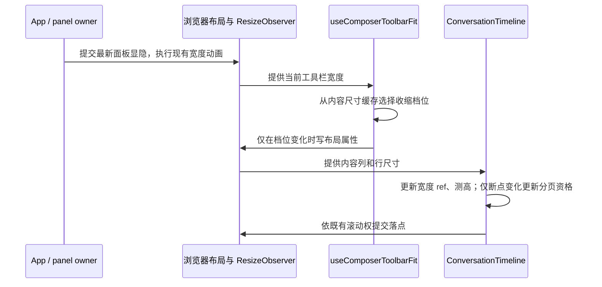

# 对话面板宽度变化的性能契约

## 产品规则

- Desktop 与宽屏 Web 的右侧面板继续使用现有展开/收起动画，快速反向点击应立即响应最新显隐状态；不增加点击节流、额外等待或业务队列。
- 长对话、短对话共享同一布局逻辑。消息内容、工具执行状态、模型配置和草稿不因面板切换而改变。
- 输入框工具栏维持现有收缩顺序：Computer、mode、Plan、think 文案，provider 前缀，think 图标态，最后模型图标态。宽度恢复后应恢复能够容纳的完整文案。所有按钮、菜单、焦点和 Tooltip 保持原有交互。
- 模型/语言/权限/思考档位/动态工具入口变化以及字体加载后，需要重新计算工具栏所需空间。手机窄屏、桌面和 Web 的容器断点均适用。
- 时间线宽度变化期间保持既有滚动权：用户上滚不被抢回底部；跟随态在现有宽度稳定边界后贴底。动画中间尺寸不应反复改变目录分页资格或生成额外完整历史请求。

## 状态所有者与接口

- 面板显隐由已有 App panel state 与 `useAnimatedResizablePanel` 拥有。
- `useComposerToolbarFit` 只拥有工具栏 DOM 布局投影与组件实例内尺寸缓存。它不写模型/权限/Plan/CUA 业务状态，不引入跨组件或跨会话缓存。
- `ConversationTimeline` 拥有当前宽度、宽度变化判定、虚拟列表测高和滚动权。ResizeObserver 提供的尺寸是本轮测量事实；逐项测高不能为了判断宽度变化而再次同步读取 DOM。
- 目录完整历史的资格仅依赖是否达到 864px 断点；同一断点内逐像素尺寸变化不应触发 React state 更新。
- 所有改动在 `ui` 模块内部，不增加跨模块接口、平台调用、持久化或协议。

## 性能与失效边界

- 仅宽度变化时，工具栏复用已测量的收缩档位；不逐帧克隆工具栏、插入探针并交错读写几何。
- 内容失效时可以重新测量隐藏副本；测量副本必须隔离布局影响，不能获得焦点或响应指针，测量结束与组件卸载时必须清理。
- ResizeObserver 的同一批尺寸通知使用提供的尺寸；回调执行顺序不同不能导致跟随态错误或首次宽度变化漏判。
- 无 ResizeObserver 的环境保留一次初始化与窗口 resize 的可用路径。未挂载、隐藏或已卸载组件不执行残留测量任务。
- 不改变整轮虚拟化粒度、stream/snapshot/replay 语义及已有宽度稳定时间；此次优化直接移除重复同步排版，不用新的超时掩盖问题。

## 验收场景

1. 长正文与短正文分别连续开关面板 8 次，最终显隐、工具栏与宽度正确；长正文的主线程同步样式/布局耗时和长帧显著下降。性能结果以同一开发运行时前后采样记录，避免依赖 CI 机器的绝对帧率断言。
2. 在多个宽度来回切换时，工具栏按现有优先级收缩并恢复，菜单/焦点不因隐藏测量副本丢失；只有宽度变化时不重复建立测量副本。
3. 中英文、模型/provider 文案改变、动态控件增删、字体加载后缓存失效，最终无重叠或页面横向溢出。
4. 时间线宽度变化与逐项 ResizeObserver 通知次序颠倒时，仍正确暂停 resize 期间的逐项滚动补偿；同一 864px 断点内不逐像素更新分页资格。
5. 跟随底部与离底阅读分别快速切换面板，保持原有用户滚动权；切换任务和卸载不遗留 observer、rAF 或测量节点。
6. 执行针对性回归测试、浏览器 E2E，以及根目录 `pnpm typecheck`、`pnpm lint` 和 `pnpm architecture:check --changed`，真实记录已有失败。

## 实现与验证入口

- `packages/ui/src/prompt-editor/composerToolbarFit.ts` 缓存八个收缩档位的所需宽度。内容或字体失效时批量建立隐藏副本、统一测量并清理；ResizeObserver 宽度通知只选择已缓存档位。不同实际使用的 composer 容器断点分别缓存。
- `packages/ui/src/v4/conversationTimelineResize.ts` 保存当前与稳定宽度。行测高先记录同一 ResizeObserver entry 的 inlineSize，避免行 observer 早于内容列 observer 时漏判。目录资格保持现有取整后的 864px 边界。
- 单测：`node --import tsx --test packages/ui/test/composerToolbarFit.test.ts packages/ui/test/conversationTimelineResize.test.ts`。
- 浏览器 E2E：`node packages/ui/test/conversation-resize-fixture/run-e2e.mjs`。已安装 Chrome 的环境可用 `RESIZE_FIXTURE_BROWSER` 指定可执行文件。fixture 自动管理独立服务器和浏览器，结果写入 `output/playwright/conversation-resize/`，不连接用户桌面应用。

2026-10-10 在同一个 Desktop 开发窗口、196 行/4 轮、1389 个挂载 DOM 元素上连续切换 8 次（110ms 目标间隔）：未启用 trace 的复测中，工具栏克隆次数从 33 降为 0，超过 50ms 的帧间隔从 18 次降为 1 次，p95 帧间隔从 100ms 降为 26.4ms，最长帧间隔从 150.1ms 降为 66.8ms。trace 对照的样式与布局总耗时从 1258.6ms 降为 451.0ms（约 64%）。这些是单次开发运行时观察，不作为机器无关的绝对帧率保证；面板库注册和侧面板可见宽度测量仍有残余布局成本。
