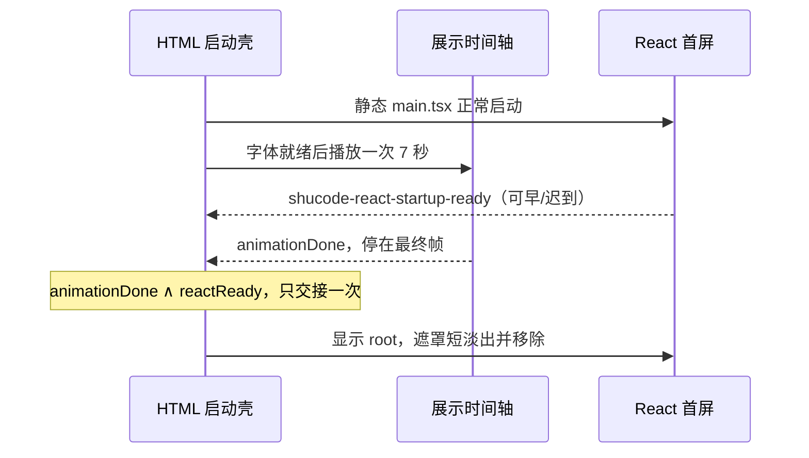

# 桌面 UI：像素超频开场动画（方案 02 已确认）

## 产品规则

用户已确认 `z-work/ui-prototypes/startup-animations/02-pixel-overdrive.html`。桌面窗口每次冷启动与重开播放一次约 7 秒「PIXEL OVERDRIVE」开场：像素引信 → 透明 Chef 点阵集结 → 朱红巨幅 SHU / CODE 切割 → Chef、Shucode 字标与印章定格。无声，无播放控制，不新增设置或持久化，不接入原型演示播放器。

动画是纯展示层；生产 Main/Host、服务启动、登录、工作区、React 首屏 commit、启动统计和 `shucode-react-startup-ready` 事件保持原接口与顺序。React 在遮罩后正常启动；动画结束且既有首屏 ready 信号到达后退场（保留旧 3000ms 的 HTML 壳恢复路径，并不将该恢复定时器描述为实际 commit）。用户选定的 7 秒展示时长属于本次开场实现，实际业务初始化不等待动画完成。

启动视觉为确认原型的米纸 `#f7f4e9`、墨 `#22251f`、朱红 `#e74728`，仅开场排版阶段使用大面积朱红。深系统主题使用深棕纸面与米白文字，排版仍使用朱红/米白。此艺术开场的字标属于品牌图形尺寸，不是业务控件字号；工作区继续遵守 DESIGN.md 的 UI 字阶。启动 CSS 内联独立成立，本地 Kitchen Pixel 字体复用 `renderer/public/fonts/`，不加载外部字体或图像。

## 所有者与接口

- `packages/desktop/src/renderer/index.html` 内联启动脚本是唯一动画时间轴及退场门闩所有者；requestAnimationFrame 按 performance.now 推进，场景绘制由同一 elapsed 派生，种子固定，可重现画面。末帧停止绘制。
- `StartupReadyNotifier` 仍在 React 首次 commit 派发 `shucode-react-startup-ready`，内联脚本先监听后推进；信号早到或迟到只设置一次事实，不重播动画。
- 退场门闩是 `animationDone && reactReady`，幂等，只退场一次。保留现有 3000ms React-ready 恢复定时器与动画时长 + 400ms 的后台 rAF 恢复边界；不增加业务状态或新的同步路径。
- 更新状态窗口 `windowKind=update-status` 在初始化前直接移除启动壳，不加载字体或调度动画。
- `packages/desktop/scripts/build-splash-mark.mjs` 从已确认 `packages/ui/src/assets/pixel-kitchen/chef.png`（512px、8px原生格）生成 64×64 调色板/4bit 索引，写入现有 `splash-mark-data` 标记。文件 IO 为异步，生成物不可手写；`--check` 校验一致性。UI 启动期读取内联数据，不跨包导入实现。
- 绘制仅维护 canvas backing buffer 和静态 palette/cells，resize重画当前时间，不开启第二条时间轴。DPR 上限 2；虚拟镜头宽 1200、高度按窗口比例，中心艺术区域在矮/窄窗口等比缩放避免裁切。
- 动效画布始终覆盖完整窗口，不能因为标题栏安全区产生横向封口、竖向断裂或内嵌画框。标题栏安全区只约束品牌角标和 Windows/Linux 自绘窗控；主体 Chef、粒子、扫描线、切割条和排版继续从窗口边缘连续绘制。macOS 保留 Main 的原生红绿灯位置，角标与按钮避开该区域。
- 顶部角标距安全区下沿仅 12 CSS px，字号固定 12 CSS px，不再叠加原型的 40 艺术单位留白；主体以整个窗口中心构图，按可用高度缩放，避免因避让标题栏而整体下移。
- Windows/Linux 使用现有 React 自绘窗口控件。启动期由展示组件通过 portal 复用 `DesktopWindowControls`，挂到启动壳预留的右上角容器，继续通过 `usePlatform` 和既有桌面命令执行最小化、最大化/还原、关闭。macOS 不渲染第二套按钮；更新状态窗口不挂启动期控件。
- 启动 HTML 仍是退场的唯一所有者。控件组件只观察容器是否连接，壳移除时卸载 portal 和清理观察器，不引入启动状态或第二条退场时间轴。正常首屏与数据库恢复首屏均提供相同平台/国际化上下文，排版阶段的控件颜色保持可读。

## 时间轴

| 时间       | 场景                                                 |
| ---------- | ---------------------------------------------------- |
| 0–1.13s    | 引信线、像素块、旋转红像素和计数排版                 |
| 1.13–2.85s | 固定种子的像素由外围吸附到 Chef 原生格位，轨道收束   |
| 2.85–4.34s | 朱红舞台，巨幅 SHU / CODE 相向切入、黑色切割条与格纹 |
| 4.34–6.4s  | 米纸回归，Chef 缩放落位、字标逐字抬升、红光标和印章  |
| 6.4–7s     | 稳定品牌画面，7 秒后停止；若首屏迟到保持最终帧       |
| 交接       | 约 340ms 遮罩淡出，根首屏显现；减少动态效果直接交接  |

## 降级与清理

- `prefers-reduced-motion: reduce` 不执行动画 rAF，不等待 7 秒，立即绘制品牌最终帧；保留首屏 ready 门闩，移除位移/淡入淡出和所有闪烁。
- 字体通过本地 FontFaceSet 加载后开始，失败使用系统等宽字标，不阻塞启动。字体未就绪期间显示静态可读品牌，已有动画恢复时限从初始化计时，不可因资源异常永远遮罩。
- 严格校验原生 64×64 grid、palette、packed 和全部索引；缺失/解析失败/无 Canvas context 时静态 DOM 字标降级并立即标记 animationDone，仍等待首屏 ready。
- 后台 rAF 恢复定时器触发时先取消帧循环、绘制最终帧，再设置 animationDone；迟到帧不能重启已完成动画。退场移除 resize监听，取消 rAF、资源迟到结果与所有 owned 定时器。
- 状态文本为静态辅助技术品牌标签，不把艺术计数/装饰条宣称为真实进度。恢复根首屏时将 aria-busy=false。

## 验收与回归

先补充 `packages/desktop/scripts/check-startup-splash.mjs` 的独立真实浏览器 E2E：按当前 renderer HTML 启动脚本执行，本地 HTTP 服务字体，stub main入口只派发现有 ready事件，不模拟场景实现。

1. 正常偏好首屏先 ready：7 秒前仍被遮罩、7 秒后短退场，root正常显现，动画完整播放一次；重复 ready不重播。
2. 测试保持 ready恢复定时器尚未触发，animation先完成：终帧保持、迟到ready正确交接。后台不调度rAF时恢复路径仍结束且取消迟到帧。
3. light/dark、1440×900、1024×768和矮窗口布局及DPR2；确认Chef像素、红色切割与终帧，resize不会重播。
4. reduce：立即终帧，无7秒等待；字体失败、JSON坏数据、空palette/错误索引/无Canvas均能进入首屏。
5. update-status：同步无遮罩，无动画帧。
6. 实际 Electron/Vite 冷启动与reload验证，使用独立用户数据目录，不碰用户已开窗口和凭据。
7. 生成数据 --check、typecheck、lint、architecture、格式与diff检查，报告实测结果及未执行限制。生产build资源校验以当前可用构建命令为准，不声称跨平台原生已测。
8. 全屏动效与标题栏安全区：480×640、1200×800、1440×900 和桌面缩放 -3/0/5，Canvas 与启动壳边界完全重合，kinetic 切割条可连续穿过顶部，不出现安全区横线或内嵌画框；角标与窗控仍避开标题栏。实际 macOS 截图确认红绿灯与品牌角标无碰撞；模拟 Windows/Linux 平台验证启动期间右上角控件可见、可点击且仍发送既有命令，壳退场后无残留控件。不声称在 macOS 上完成原生 Windows 验证。
