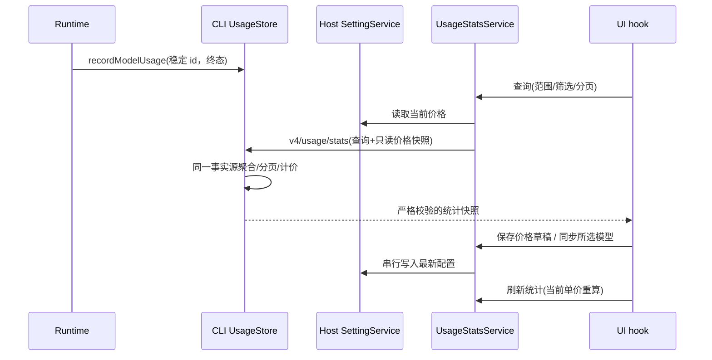

# Shucode 用量统计与模型定价

## 目标与已确认范围

将 CC Switch 的用量统计能力接入现有「使用统计」设置页。用户最新确认扩大为 Shucode 与外部主流客户端，并长期保留用量历史；包含模型定价管理、models.dev 导入/同步。桌面保持 DESIGN.md 的纸墨视觉；Web/手机使用现有组件与主题。

参考实现基线为 farion1231/cc-switch 的 `5667b287c6e1a8cc54e527bafc3c72d59f312b99`。借鉴统计语义和交互，使用本项目的 TypeScript、RPC 和 CLI 数据库实现；不引入 Rust/Tauri 代理。外部适配器包括 Codex、Claude Code、Pi、Gemini、OpenCode，以及用户指定的 anywhere-labs/dsh-desktop。其它主流客户端在确认实际数据格式后接入，不将未实现来源显示为可用。

## 产品规则

- 当前 Environment 的 CLI usage store 是用量唯一事实源，同一库的多个 workspace 不重复合计。桌面本地查询排除远端 client；远端 workspace 使用其现有连接。手机通过现有 Host attachment 查询，不启动独立 Agent。
- 标题右侧使用胶囊式 Shucode / 所有客户端切换，默认 Shucode。所有客户端读取当前 Host 本机安装的客户端日志，加当前 Environment 的 Shucode 查询，不跨 Host 隐式合计。客户端图标胶囊带 tooltip 与可访问名称，支持全部与各客户端筛选。
- 首页展示参考费用、模型调用数、真实消耗 Token、缓存命中率。调用数是已持久化 model step 数；内部 HTTP 自动重试不冒充独立调用。记录中展示 retryCount/source/status。
- 时间范围包含今天、近 24 小时、近 7/14/30 个自然日、全部、自定义日期与时间。自定义结束时间可选择跟随当前时刻。浏览器传 IANA 时区；新仪表盘按真实日历日期归桶，覆盖夏令时；旧查询兼容原 all/7d/30d 参数。
- provider/model 筛选作用于同一仪表盘的摘要、趋势、供应商/模型汇总与日志。状态筛选作用于日志。趋势可切换 Token/调用/费用，今天按小时，其余按日。
- 请求日志采用稳定 `(startedAt,id)` 倒序和有界分页，每页默认 20，最多 100；快照时刻固定查询上界，避免刷新期间新数据挤动分页。查询不返回提示词、rawUsage、provider metadata、完整错误消息。
- 相同时间的 ID 顺序采用 UTF-8 字节的 SQLite BINARY 顺序，联邦合并使用同一比较器，包含 Unicode ID 时游标也不能改用 localeCompare 或 JavaScript UTF-16 字符序。小时趋势显式捕获时区 offset 变化产生的短桶，支持半小时 DST 回拨，不能只按一小时采样而漏掉有真实用量的桶。
- 未知 provider/model 显示未知；不存在价格或未上报用量的调用显示未计价。摘要明确未计价调用数；未知不等于零费用。费用是当前单价下的参考估算，不是供应商账单。
- 全部时间范围使用最近 53 周热图，支持 Token/调用/费用指标；其它范围展示趋势图。现有活动视图保留热图和模型趋势但移除旧五项顶部摘要。取消隐式 30 天自动清理。已有被清理数据不可恢复。

## 外部客户端采集

外部日志只读，不修改客户端配置、数据库、WAL 或会话文件。Host 的外部用量服务是增量导入和派生 SQLite 账本的唯一所有者；UI/RPC 不直接读文件。默认路径通过 os.homedir()/path 构造，支持 Windows/macOS/Linux；没有路径不报失败，有权限/格式错误则逐来源报告。外部来源只提取时间、模型、供应商（实际存在时）、Token、耗时、自报成本和稳定事件 id，不保存聊天文本或凭据。

导入在服务内 single-flight，首次/手动与每 60 秒的查询触发刷新共用同一入口。按文件 mtime/size 变化检测，完整 JSON/JSONL 行才消费；截断/重写重新解析并以稳定 client+session+event id upsert，缺少稳定 id 用明确结构化字段摘要。Codex 优先 last_token_usage，累计 fallback 用高水位差分，fork/replay 前缀不能重复记账；Claude 多内容块按 message id 合并最终 usage；Pi 的 usage 原始 input 是 fresh input，导入时归一到 total input。外部没有可证实的供应商/HTTP 状态时显示来源/未知，不伪造供应商成功率。

手动刷新即使退出固定分页快照也强制同步外部日志。自定义 until、分页 until 与当前时刻均是查询上界，最终截止时间取三者最小值；分页不能因顶层自定义结束时间覆盖快照界限。

Claude 同一源 message 可能存在于多个复制/fork 文件，跨文件 upsert 同样优先已确认终态，不能由较旧 partial 覆盖；同等级快照优先较大 output，output 相等时允许最新 cache/provider 计量更新。明确失败但缺 usage 的调用仍计数且未计价，不生成虚构 Token。

所有客户端界面由两份已有 owner 的查询结果联邦合并：Shucode CLI 与外部派生账本。明细 id 带来源前缀；统一 startedAt/id cursor、until 截止时刻进行有界合并分页，避免扫描所有历史或将 Shucode 再复制成第二份事实。客户端不存在或单源失败不让已可用来源消失，sourceErrors 可见。

外部文件分批写入临时 SQL 投影，只有整文件解析成功后才原子 upsert 与提交指纹；失败不留下半批用量。多个 Host 服务集合共享一个按本地数据目录引用计数的采集 owner，最后释放者等待正在读取的文件结束后关闭账本。远程工作区直接使用远端既有 usageStatsService，全部客户端和定价均属于远端 Host；快照 source 为 federated，不假称全部数据来自 CLI。

DSH Desktop 格式以 https://github.com/anywhere-labs/dsh-desktop 的实际源码确认后实现并记录基线。其 `session.v4.jsonl.zstd` 是多个独立 Zstandard frame 追加形成的事件流，读取时必须逐 frame 解压；只解压首 frame 会把可用会话误报为空。若其持久化内容未保存真实 usage，则显示不可用并说明缺少真实数据，不通过字符数量估算账单。

## Token 与成本

CLI 归一化的 inputTokens 已包含 cacheRead/cacheCreation；outputTokens 已包含 reasoning。所有计算使用这一契约，不按客户端名称猜输入语义。

```text
freshInput = max(0, inputTokens - cacheReadTokens - cacheCreationTokens)
realTotal = inputTokens + outputTokens
cacheHitRate = sum(cacheReadTokens) / sum(inputTokens)
estimatedUSD = (freshInput × inputPrice + outputTokens × outputPrice
              + cacheReadTokens × cacheReadPrice
              + cacheCreationTokens × cacheWritePrice) / 1,000,000
```

价格字段为 USD/百万 Token，有限非负数；支持明确的 0 单价。缺少某缓存单价时，相关缓存 Token 大于 0 的记录不可完整计价，不擅自按普通输入价格替代。使用整数金额单位累加，避免浮点累计漂移；最终展示保留适当小数。

外部记录没有匹配价目表时，可使用客户端明确上报的有限非负 cost；已有匹配价格但缓存单价不完整时继续显示未计价。日志 costSource 明确区分 estimated 与 client-reported，0 自报成本仍是已知费用，不能当成缺失。

成功且具有 provider usage 的调用可计价；失败/取消且无 usage 的记录只能计入调用数/状态，费用未知。已有字段不能区分缓存 TTL，首版使用用户配置的统一缓存写入单价。

## 定价管理与同步

- 价格唯一持久化所有者是 Host 的现有 SettingService（新增可选 usagePricing 设置）；CLI 只接收本次查询的只读价格快照，不保存第二份价目表，不修改历史用量。
- 价格优先级：精确 providerId+modelId 的手工价格 > modelId 通用手工价格 > models.dev 精确模型导入价格。不同供应商的同名导入模型不得随意互相覆盖。
- 可新增/编辑/删除价格；四类单价、模型 ID、供应商可选、显示名称、来源均显式记录。修改价格后，同一用量按当前价重算，界面说明此行为。
- models.dev 由服务网络 adapter 经现有 ApiClient 请求固定公开 HTTPS endpoint，无认证信息；校验响应后预览候选，允许选择导入。手工价格不被同步覆盖。
- 自动同步默认关闭；开启后由服务在用量/价格查询时触发，成功同步间隔至少 6 小时，同一 service 内共享进行中的同步。首次无配置不自动访问外网；手动立即同步可强制刷新已选择的模型。失败保留旧价格和成功时间，不报告成功。
- 设置写入通过服务单一路径串行提交；同步从网络返回后重新读取最新设置再合并，防止覆盖并发手工编辑。UI 只保留编辑草稿和查询投影。
- 支持粘贴或选择 CC Switch 的 `model-pricing.json` 导入，格式以参考版本的 `src-tauri/src/services/model_pricing.rs` 为准：`version` 缺省为 1，支持 0/1；`models` 为 camelCase 模型价格数组，四个 `*CostPerMillion` 十进制字符串直接映射 USD/百万 Token，不缩放单位。完整校验后一次提交，非法 JSON、未来版本、非法单价或超出 2000 模型限制均拒绝并给出字段路径，不能部分成功。
- 导入只读取用户选择或粘贴的 JSON；不主动读取 CC Switch 设置目录。导入条目无 provider 字段，使用模型通用手工价，不按模型名猜供应商。已存在相同 key 的 Shucode 手工价优先保留，重复导入幂等；文件内同名模型后者优先。`deletedModelIds` 只过滤本次候选，不能删除 Shucode 已有模型；`modelsDevSync` 不迁移开关、选择或同步时间。导入响应返回保存后的设置和导入/跳过数量。
- 开发期 Renderer 热更新不会替换已运行的 Host 服务对象；若导入返回 `Method not found: importCcSwitchPrices`，界面提示完整退出并重启 Shucode，不误报 JSON 格式错误，也不自动中断正在运行的会话。
- 外部事件去重优先使用客户端提供的事件 ID，而不是会话目录：Claude 使用 `message.id`，Pi 使用有 `entry.id` 的条目 ID；这样复制或 fork 的日志不会重复计费。缺少源 ID 时才使用包含会话、时间、模型、Token 与事件类型的结构摘要。该规则只约束外部账本的幂等键，不改变 workspace identity。

## 接口与所有者

共享 schema 位于 packages/shared/src/usage-stats.ts 及新增 usage-dashboard/pricing 协议文件，通过 @shucode/shared 公开导出。v4/usage/stats 的扩展入参与旧 usage/stats 校验同步更新。旧消费者仍可请求原 AppUsageSnapshot；新 dashboard 数据通过可选字段扩展。



这条链是只读 query，不修改会话 stream、snapshot、CommandInbox 或 owner/lease。desktop-continuous 和 web-remote-replayable 仍读取同一既有 owner。切换 Environment、筛选或卸载立即使旧 UI 请求失效；自动刷新默认 30 秒且单次查询结束后才安排下一轮，不堆积请求。

Host 用量服务关闭后，进行中的定价/统计查询在异步边界检查销毁状态，不能再获取外部采集 owner 或创建 SQLite 句柄。已获取 owner 的关闭等待当前扫描结束；引用计数归零时释放，新 owner 打开同账本前等待旧 owner 完成关闭。

## 数据库迁移（用户已确认）

当前 model_usage、turn_usage、tool_usage 的 session 外键为 ON DELETE CASCADE。用户已确认长期统计独立于会话删除：添加下一版本 SQLite migration，在同一事务中重建三张表，复制原列与记录，保留主键、索引及幂等约束，只移除 session 的级联外键。ID 继续用于关联与筛选，不要求对应会话仍存在。迁移不会回填已删除历史；无下行迁移，回退旧程序仍能查询同列数据，但旧程序的自动 30 天清理可能再次删历史，应在回滚前备份数据库。

## 验收场景

| 场景          | 操作与断言                                                                                                            | 验证层          |
| ------------- | --------------------------------------------------------------------------------------------------------------------- | --------------- |
| 缓存与推理    | 合成 input=1000/read=600/write=100/output=200/reasoning=50；普通输入=300、总量=1200、命中率=60%，reasoning 不重复计价 | 纯函数 + SQLite |
| 同名模型      | 两供应商同模型分别写入；provider 筛选和定价独立，通用价格仅按明确优先级兜底                                           | SQLite + 协议   |
| 未计价        | 无价格、缺缓存单价、error/cancelled 无 usage；日志为空费用，摘要增加未计价数                                          | 纯函数 + UI     |
| 历史保留      | 写入超过 30 天的 usage，再记录新调用；旧记录仍存在、累计/热图可查询                                                   | SQLite          |
| 幂等与分页    | 同 id 重写不增加调用；相同时间不同 id 稳定排序；固定 until 下页不受新插入影响                                         | SQLite          |
| 日界与 DST    | 今天/7d/30d 的本地日边界正确，DST 日按实际日历日期归桶                                                                | 时间函数        |
| 定价保存      | 有效 0 单价可保存；负数/NaN/非法配置拒绝；保存后成本重算、手工价格不被导入覆盖                                        | 服务 + UI       |
| 同步失败/竞态 | 网络失败保留旧价；并发手工编辑不丢失；重复同步共享进行中请求                                                          | 服务            |
| 交互          | 切换范围、provider/model、指标、日志分页、价格 CRUD/导入、自动刷新；旧响应不能覆盖新查询                              | 浏览器 E2E      |
| 平台          | 手机宽度、中英文、明暗主题，当前 Environment 隔离，无活跃 workspace 的失败明确                                        | UI/服务         |

## 验证命令与限制

必须执行 pnpm typecheck、pnpm lint、pnpm architecture:check --changed；涉及 CLI 还执行 pnpm --dir apps/shucode-cli typecheck 和 lint。新行为测试沿用 node:test + tsx，以实际新增测试路径运行。仓库目前没有统一 test/e2e 脚本，交互验收使用可用浏览器自动化及隔离 fixture，并如实记录未能运行的场景。源码文件遵守 CLI 默认 400 行限制；不更新架构 baseline。
